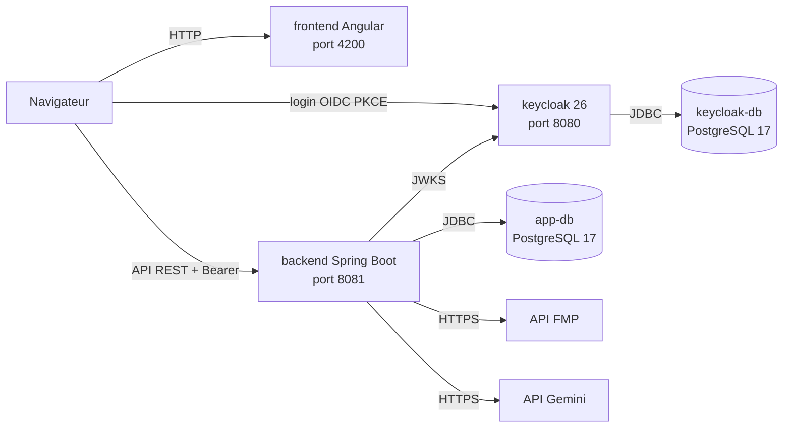

# FinanceHub — Infrastructure et démarrage

FinanceHub est une application d'analyse financière : un frontend Angular, une API Spring Boot qui agrège des données de marché (FMP) et des filings SEC, et une authentification OIDC portée par Keycloak.

Ce dépôt contient la partie infrastructure : Keycloak, son realm `dev-realm` avec son thème, et les bases PostgreSQL.

> **Avertissement** : tous les mots de passe et secrets de ce dépôt sont destinés uniquement au développement local. Ne pas les utiliser en production.

## Architecture



Docker Compose démarre les trois conteneurs d'infrastructure : `keycloak`, `keycloak-db` et `app-db`. Le frontend et le backend ont leurs propres dépôts et se lancent séparément, comme décrit dans les sections ci-dessous.

## Démarrage rapide

Prérequis : Docker (Docker Desktop sous Windows et macOS, Docker Engine avec Compose v2 sous Linux). Les ports 8080, 5433 et 5434 doivent être libres.

**1. Cloner les dépôts**

```bash
git clone https://github.com/CkalaiGit/Infra-KC_projet_finance.git
git clone https://github.com/CkalaiGit/finance-app-backend.git
git clone https://github.com/CkalaiGit/frontend-financeHub.git
```

Arborescence attendue (les noms de dossiers sont ceux créés par `git clone`) :

```
projet/
├── Infra-KC_projet_finance/   # ce dépôt : Keycloak, bases de données
├── finance-app-backend/       # API Spring Boot
└── frontend-financeHub/       # application Angular
```

Pour démarrer l'infrastructure seule, seul `Infra-KC_projet_finance/` est nécessaire.

**2. Copier le fichier d'environnement (facultatif)**

Les valeurs par défaut du `docker-compose.yml` correspondent à `.env.example`. Cette copie n'est nécessaire que si vous voulez pouvoir modifier ces valeurs.

Bash :
```bash
cp .env.example .env
```

PowerShell :
```powershell
Copy-Item .env.example .env
```

**3. Clés d'API (uniquement pour le backend)**

- `FMP_API_KEY` : données de marché. Clé gratuite disponible sur https://site.financialmodelingprep.com/developer/docs (quotas limités).
- `GEMINI_API_KEY` : module IA. Clé gratuite disponible sur https://aistudio.google.com/apikey (quotas limités).

Docker Compose ne lit pas ces variables : elles sont passées au backend au moment de son lancement (voir « Lancer en mode développement »). Cette étape n'est pas nécessaire pour démarrer l'infrastructure.

**4. Démarrer l'infrastructure**

Depuis le dossier `Infra-KC_projet_finance/` :

```bash
docker compose up --build -d
```

Le premier lancement télécharge les images `postgres:17` et `quay.io/keycloak/keycloak:26.0`, ce qui prend quelques minutes selon la connexion. Au démarrage, Keycloak importe le realm `dev-realm` ; l'import dure environ 20 secondes.

Vérifier l'état :

```bash
docker compose ps
```

`app-db` et `keycloak-db` passent à `healthy`. Keycloak n'a pas de healthcheck : la console est prête quand `http://localhost:8080` répond.

## URLs

| Service | URL | Lancé par |
|---|---|---|
| Application Angular | http://localhost:4200 | `npm start` dans `frontend-financeHub` |
| API Spring Boot | http://localhost:8081/api/v1 | `.\mvnw.cmd spring-boot:run` (ou `./mvnw`) dans `finance-app-backend` |
| Swagger UI | http://localhost:8081/swagger-ui.html | backend |
| Console Keycloak | http://localhost:8080 | `docker compose` |
| Keycloak (base) | localhost:5433 | `docker compose` |
| app-db (PostgreSQL) | localhost:5434 | `docker compose` |

Base applicative : base `financeapp`, utilisateur `financeapp`, mot de passe `financeapp` (valeurs par défaut).

## Comptes de démonstration

| Identifiant | Mot de passe | Rôle | Usage |
|---|---|---|---|
| `warren` | `password` | PREMIUM | Application (`http://localhost:4200`) |
| `michael` | `password` | FREEMIUM | Application (`http://localhost:4200`) |
| `admin` | `admin` | Administrateur Keycloak | Console Keycloak, realm `master` |

**Identifiants de développement uniquement.** Ils sont publics dans ce dépôt et ne doivent jamais être utilisés en production.

La page de connexion du realm `dev-realm` permet aussi de créer un compte.

## Dépannage

**Port déjà utilisé**

Identifier le processus qui occupe le port :

```powershell
netstat -ano | findstr :8080
```
```bash
lsof -i :8080
```

Pour changer le port exposé, modifier la section `ports` du service concerné dans `docker-compose.yml`, par exemple `"8180:8080"` pour Keycloak, puis relancer `docker compose up -d`.

Attention : changer le port de Keycloak change l'URL de l'issuer. Le backend valide le claim `iss` contre `http://localhost:8080/realms/dev-realm` : il faudra alors adapter sa configuration, sinon l'API répondra 401. Pour `app-db`, il faut aussi adapter l'URL JDBC du backend (port 5434).

**Conteneur unhealthy ou qui ne démarre pas**

```bash
docker compose ps
docker compose logs app-db
docker compose logs keycloak-db
docker compose logs keycloak
```

**Clé d'API manquante**

Le backend démarre sans `FMP_API_KEY` ni `GEMINI_API_KEY`. Les appels aux données de marché échouent alors :

- réponse HTTP `503` avec le code `MARKET_DATA_UNAVAILABLE` ;
- dans les logs du backend : `FMP configuration failure: status=401, endpoint=/stable/profile, symbol=AAPL`.

Les appels Gemini échouent seulement à l'usage, pas au démarrage.

**Réinitialisation complète**

```bash
docker compose down -v
docker compose up --build -d
```

`down -v` supprime les volumes : les données de Keycloak et de `app-db` sont effacées, et le realm est réimporté au démarrage.

**401 sur l'API**

- Le token doit provenir de `http://localhost:8080`, car le claim `iss` doit être `http://localhost:8080/realms/dev-realm`. Ne pas obtenir de token via `127.0.0.1` ou `keycloak:8080`.
- Un token expiré donne aussi 401 : se reconnecter.
- Sans token, l'API répond 401 (attendu). Avec un token valide, par exemple celui de `warren`, `GET /api/v1/watchlist` répond 200.

## Lancer en mode développement

En mode développement, seules les bases et Keycloak tournent dans Docker. Le backend et le frontend tournent sur la machine hôte, ce qui permet de relancer l'application sans reconstruire d'image.

```bash
docker compose up keycloak-db keycloak app-db -d
```

Backend (dans `finance-app-backend/`), avec les clés d'API dans l'environnement du terminal :

Bash :
```bash
export FMP_API_KEY=votre_cle_fmp
export GEMINI_API_KEY=votre_cle_gemini
./mvnw spring-boot:run
```

PowerShell :
```powershell
$env:FMP_API_KEY = "votre_cle_fmp"
$env:GEMINI_API_KEY = "votre_cle_gemini"
.\mvnw.cmd spring-boot:run
```

Frontend (dans `frontend-financeHub/`) :

```bash
npm install
npm start
```

L'application est ensuite disponible sur http://localhost:4200. Connectez-vous avec `warren` ou `michael`.

Le profil Spring par défaut pointe sur `localhost:5434` (base) et `localhost:8080` (Keycloak). Le profil `docker` (`SPRING_PROFILES_ACTIVE=docker`) est réservé à un backend lancé dans un conteneur sur le réseau Compose.
