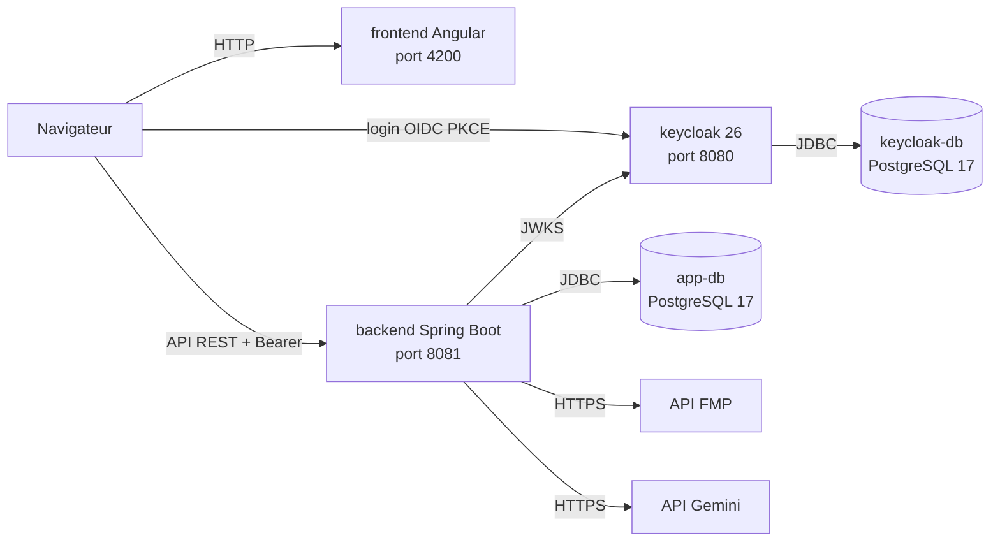

# FinanceHub — Infrastructure et démarrage

FinanceHub est une application d'analyse financière : un frontend Angular, une API Spring Boot qui agrège des données de marché (FMP) et des filings SEC, et une authentification OIDC portée par Keycloak.

Ce dépôt contient la partie infrastructure : Keycloak, son realm `dev-realm` avec son thème, et les bases PostgreSQL.

> **Avertissement** : tous les mots de passe et secrets de ce dépôt sont destinés uniquement au développement local. Ne pas les utiliser en production.

## Architecture



Ce dépôt contient le point d'entrée unique : `docker compose up --build -d` lance les cinq services de l'application (`keycloak`, `keycloak-db`, `app-db`, `backend`, `frontend`). Le backend et le frontend sont construits à partir de leurs propres dépôts, situés à côté de celui-ci.

## Démarrage rapide

Prérequis : Docker uniquement (Docker Desktop sous Windows et macOS, Docker Engine avec Compose v2 sous Linux). Les ports 4200, 5434, 8080 et 8081 doivent être libres.

**1. Cloner les dépôts**

```bash
git clone https://github.com/CkalaiGit/Infra-KC_projet_finance.git
git clone https://github.com/CkalaiGit/finance-app-backend.git
git clone https://github.com/CkalaiGit/frontend-financeHub.git
```

Arborescence attendue (les noms de dossiers sont ceux créés par `git clone`) :

```
projet/
├── Infra-KC_projet_finance/   # ce dépôt : Keycloak, bases de données
├── finance-app-backend/       # API Spring Boot
└── frontend-financeHub/       # application Angular
```

Pour un démarrage complet, les trois dépôts sont nécessaires.

**2. Créer le fichier `.env`**

Le fichier `.env.example` contient les valeurs de développement. Copiez-le en `.env` (ce fichier est ignoré par Git) :

Bash :
```bash
cp .env.example .env
```

PowerShell :
```powershell
Copy-Item .env.example .env
```

**3. Renseigner les clés d'API (obligatoires)**

Dans `.env`, renseignez :

- `FMP_API_KEY` : données de marché. Clé disponible sur https://site.financialmodelingprep.com/developer/docs (quotas limités).
- `GEMINI_API_KEY` : module IA. Clé disponible sur https://aistudio.google.com/apikey (quotas limités).

Sans ces deux clés, `docker compose` refuse de démarrer et affiche le message `FMP_API_KEY manquante : renseignez-la dans .env` (ou l'équivalent pour Gemini).

**4. Démarrer l'application**

Depuis le dossier `Infra-KC_projet_finance/` :

```bash
docker compose up --build -d
```

Le premier lancement construit les images du backend (Maven) et du frontend (npm), et télécharge `postgres:17` et `quay.io/keycloak/keycloak:26.0`. Il dure plusieurs minutes selon la machine et la connexion. Les lancements suivants sont beaucoup plus rapides.

Vérifier l'état :

```bash
docker compose ps
```

Les cinq services doivent passer à `healthy`. Le backend ne démarre qu'une fois `app-db` et `keycloak` prêts, et le frontend n'attend que le backend.

## URLs

| Service | URL | Lancé par |
|---|---|---|
| Application Angular | http://localhost:4200 | `docker compose` (conteneur `frontend`) |
| API Spring Boot | http://localhost:8081/api/v1 | `docker compose` (conteneur `backend`) |
| Swagger UI | http://localhost:8081/swagger-ui.html | `docker compose` (backend) |
| Console Keycloak | http://localhost:8080 | `docker compose` (conteneur `keycloak`) |
| app-db (PostgreSQL) | localhost:5434 | `docker compose` (conteneur `app-db`) |

La base Keycloak n'est pas exposée sur l'hôte. Le port 5434 de `app-db` reste disponible pour lancer le backend hors Docker.

Base applicative : base `financeapp`, utilisateur `financeapp`, mot de passe `financeapp` (valeurs par défaut).

## Comptes de démonstration

| Identifiant | Mot de passe | Rôle | Usage |
|---|---|---|---|
| `warren` | `password` | PREMIUM | Application (`http://localhost:4200`) |
| `michael` | `password` | FREEMIUM | Application (`http://localhost:4200`) |
| `admin` | `admin` | Administrateur Keycloak | Console Keycloak, realm `master` |

**Identifiants de développement uniquement.** Ils sont publics dans ce dépôt et ne doivent jamais être utilisés en production.

La page de connexion du realm `dev-realm` permet aussi de créer un compte.

## Dépannage

**Port déjà utilisé**

Identifier le processus qui occupe le port :

```powershell
netstat -ano | findstr :8080
```
```bash
lsof -i :8080
```

Pour changer le port exposé, modifier la section `ports` du service concerné dans `docker-compose.yml`, par exemple `"8180:8080"` pour Keycloak, puis relancer `docker compose up -d`.

Attention : changer le port de Keycloak change l'URL de l'issuer. Le backend valide le claim `iss` contre `http://localhost:8080/realms/dev-realm` : il faudra alors adapter sa configuration, sinon l'API répondra 401. Pour `app-db`, il faut aussi adapter l'URL JDBC du backend (port 5434).

**Conteneur unhealthy ou qui ne démarre pas**

```bash
docker compose ps
docker compose logs app-db
docker compose logs keycloak-db
docker compose logs keycloak
docker compose logs backend
docker compose logs frontend
```

**Clé d'API manquante ou vide**

Compose refuse de démarrer tant que `FMP_API_KEY` ou `GEMINI_API_KEY` est absente ou vide dans `.env`. Renseignez la clé puis relancez `docker compose up --build -d`.

**Ancien `.env`**

Les variables `KEYCLOAK_ADMIN` et `KEYCLOAK_ADMIN_PASSWORD` sont remplacées par `KC_BOOTSTRAP_ADMIN_USERNAME` et `KC_BOOTSTRAP_ADMIN_PASSWORD` (Keycloak 26). Si votre `.env` a été créé avant ce changement, renommez-les, ajoutez `FMP_API_KEY`, `GEMINI_API_KEY` et `CORS_ALLOWED_ORIGINS` (voir `.env.example`).

**Réinitialisation complète**

```bash
docker compose down -v
docker compose up --build -d
```

`down -v` supprime les volumes : les données de Keycloak et de `app-db` sont effacées, et le realm est réimporté au démarrage.

**401 sur l'API**

- Le token doit provenir de `http://localhost:8080`, car le claim `iss` doit être `http://localhost:8080/realms/dev-realm`. Ne pas obtenir de token via `127.0.0.1` ou `keycloak:8080`.
- Un token expiré donne aussi 401 : se reconnecter.
- Sans token, l'API répond 401 (attendu). Avec un token valide, par exemple celui de `warren`, `GET /api/v1/watchlist` répond 200.

## Lancer en mode développement

En mode développement, seules les bases et Keycloak tournent dans Docker. Le backend et le frontend tournent sur la machine hôte, ce qui permet de relancer l'application sans reconstruire d'image.

```bash
docker compose up keycloak-db keycloak app-db -d
```

Compose valide tout le fichier avant de lancer des services : les clés `FMP_API_KEY` et `GEMINI_API_KEY` doivent donc être présentes dans `.env` même pour ce mode. Elles n'ont pas besoin d'être valides ; le backend lancé sur l'hôte utilise celles de son propre terminal.

Backend (dans `finance-app-backend/`), avec les clés d'API dans l'environnement du terminal :

Bash :
```bash
export FMP_API_KEY=votre_cle_fmp
export GEMINI_API_KEY=votre_cle_gemini
./mvnw spring-boot:run
```

PowerShell :
```powershell
$env:FMP_API_KEY = "votre_cle_fmp"
$env:GEMINI_API_KEY = "votre_cle_gemini"
.\mvnw.cmd spring-boot:run
```

Frontend (dans `frontend-financeHub/`) :

```bash
npm install
npm start
```

L'application est ensuite disponible sur http://localhost:4200. Connectez-vous avec `warren` ou `michael`.

Le profil Spring par défaut pointe sur `localhost:5434` (base) et `localhost:8080` (Keycloak). Le profil `docker` (`SPRING_PROFILES_ACTIVE=docker`) est réservé à un backend lancé dans un conteneur sur le réseau Compose.
